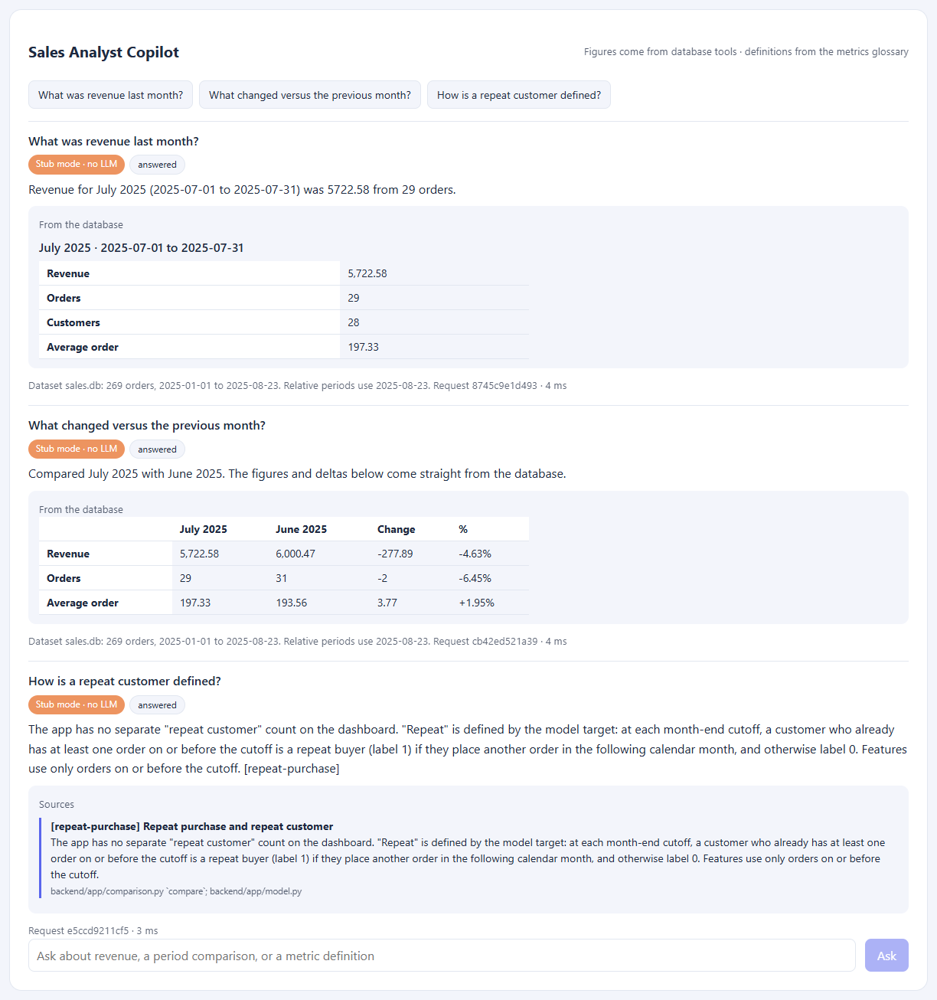

# AI Sales Intelligence

[](https://github.com/manoharreddy0206/AI-Sales-Intelligence-v2/actions/workflows/ci.yml)

**Live demo: https://ai-sales-intelligence-bzg4.onrender.com**

A sales analyst uploads a CSV or Excel file of orders and gets revenue, order, customer and average-order metrics, a monthly revenue chart, customer segments, and a repeat-purchase model comparison. A **Sales Analyst Copilot** answers questions such as "What was revenue last month?" Its figures come from the same SQL queries as the dashboard, and metric definitions are cited from a glossary in this repo.

Built with React + TypeScript (Vite), FastAPI, SQLite, pandas, scikit-learn, and the Anthropic Messages API for tool calling.

> **About the public demo.** It loads **269 synthetic orders** (60 customers, 1 Jan to 23 Aug 2025), **blocks uploads** (the upload endpoint returns 403), and runs the copilot in **stub mode**: a labelled, rule-based provider with no language model. The Anthropic integration is in the code and switches on when `ANTHROPIC_API_KEY` is set; its evaluation against a real model is **pending**. The free instance sleeps when idle, so the first request can take about 50 seconds.


## Demo walkthrough (live site)

1. **Dashboard.** The banner says the data is a seeded synthetic dataset. The cards show revenue **54,233.7**, **269** orders, **60** customers and an average order of **201.61**. Below are monthly revenue, customer segments, a customer explorer and the model comparison.
2. **Ask the copilot** *What was revenue last month?* It answers for **July 2025: 5,722.58 from 29 orders**. "Last month" is measured from the latest order in the data (2025-08-23), not from today. The *From the database* table comes from the tool result, and it matches the July bar on the chart.
3. **Ask** *What changed versus the previous month?* The backend computes July against June 2025: revenue −277.89 (−4.63%), orders −2, and average order +3.77.
4. **Ask** *How is a repeat customer defined?* The answer quotes the glossary entry and cites it as `[repeat-purchase]`, along with the code that implements it.
5. **Notice the orange *Stub mode · no LLM* badge** on every answer. With an API key, Claude picks the tools and writes the sentence, but the figures still come from the tools.



To try uploads, re-uploads and validation errors, run the app locally (below).

## Architecture

```
Browser: React + Vite (frontend/src)
  │  /api/*
  ▼
FastAPI (backend/app/main.py)
  ├─ ingest.py      validate CSV/Excel → one transaction → upsert by order_id
  ├─ analytics.py   summary(start, end): parameterized SQL → cards and chart
  ├─ comparison.py  pandas features → scikit-learn models vs a majority baseline
  └─ copilot/service.py   tool loop with limits, numeric guard, request logging
        ├─ provider.py   AnthropicProvider (Messages API) | StubProvider (no LLM)
        └─ tools.py      get_revenue_summary, compare_periods ──► analytics.summary
                         search_metric_glossary ──► glossary/metrics_glossary.md
  ▼
SQLite (orders, uploads)
```

- **Numbers come from queries.** The model can call only three typed, read-only tools. Pydantic validates their inputs and refuses unknown tools or extra fields. Both revenue tools call `analytics.summary`, the same function behind the dashboard cards. The model passes a period token such as `last_month` or `2025-07`, and Python does the date arithmetic. If the model's sentence contains a number that no tool returned, the UI flags it.
- **Definitions come from retrieval.** [backend/glossary/metrics_glossary.md](backend/glossary/metrics_glossary.md) holds each definition with a stable ID and the code location it describes. Keyword retrieval returns passages, and the copilot cites their IDs. A term with no entry returns "no glossary entry" rather than a made-up definition.
- **Provider choice.** With `ANTHROPIC_API_KEY` set, [provider.py](backend/app/copilot/provider.py) calls the Anthropic Messages API (default model `claude-haiku-5-5`) using only the standard-library HTTP client. Without a key, `StubProvider` emits the same tool calls from keyword rules, so the whole tool loop and UI still run, and every answer is labelled.
- **Guardrails.** Each question gets at most 4 tool calls and 4 model turns, a 20 s provider timeout and a 30 s overall deadline. Questions are capped at 500 characters, and demo mode allows 30 questions per client per 10 minutes. Logs record the request ID, tool names, outcomes and elapsed time, but not the question text or any order rows.
- **Imports are all-or-nothing.** A file is validated in full and written in a single transaction. One bad row rejects the file, and re-uploading an existing `order_id` updates it in place.

The [engineering story](docs/ENGINEERING_STORY.md) has a 90-second demo script and a real bug with its regression test. The [evaluation notes](docs/EVALUATION.md) have the full results.

## Run it locally

Requirements: Python 3.12 and Node.js 22. The repo also includes a Codespaces dev container.

**1. Backend** (terminal 1, from the repository root):

```bash
cd backend
python -m venv .venv
source .venv/bin/activate          # Windows PowerShell: .venv\Scripts\Activate.ps1
python -m pip install --upgrade pip
python -m pip install --only-binary=:all: -r requirements.txt
python -m uvicorn app.main:app --reload --host 0.0.0.0 --port 8000
```

Check it: `curl http://localhost:8000/api/health` should return `{"status":"ok","orders":0,"demo_mode":false,"copilot_mode":"stub"}`.

**2. Frontend** (terminal 2, from the repository root):

```bash
cd frontend
npm ci
npm run dev
```

Open http://localhost:5173. Vite proxies `/api` to port 8000.

**3. Try the import path** with the files in `backend/`:

| Upload in this order | Rows | Expected result |
| --- | --- | --- |
| `sample_sales.csv` | 269 | `Import complete: 269 added / 0 updated / 0 unchanged` |
| `sample_updates.csv` | 20 | 5 added, 10 updated, 5 unchanged; 274 orders stored |
| `sample_invalid.csv` | 5 | Rejected at line 6 (negative amount); still 274 stored |

`python generate_sample.py` (run from `backend/`) regenerates all three files deterministically.

**Optional: turn on the real model.** Set the key in the backend terminal before starting uvicorn:

```bash
export ANTHROPIC_API_KEY=...        # PowerShell: $env:ANTHROPIC_API_KEY="..."
```

**Single container** (the same image the live demo runs):

```bash
docker build -t sales-intel .
docker run --rm -p 8000:8000 -e DEMO_MODE=1 sales-intel
python scripts/smoke_test.py http://localhost:8000
```

The app is then at http://localhost:8000; FastAPI serves the built React app.

**Environment variables** (all optional, backend only; see [.env.example](.env.example)):

| Variable | Default | Purpose |
| --- | --- | --- |
| `ANTHROPIC_API_KEY` | unset | Enables real tool calling. Without it, the copilot runs in labelled stub mode. |
| `COPILOT_PROVIDER` | auto | `anthropic` or `stub`. Leave unset to choose from whether a key is present. |
| `COPILOT_MODEL` | `claude-haiku-5-5` | Anthropic model ID |
| `DEMO_MODE` | `0` | `1` seeds the sample into an empty database and disables uploads |
| `SALES_DB` | `backend/sales.db` | SQLite file location |

## Tests and evaluation

```bash
cd backend
python -m pytest -q                             # unit + FastAPI HTTP tests
python -m eval.run_eval                         # 24-case copilot eval, stub provider
python -m eval.run_eval --provider anthropic    # same eval on the real model (needs the key)
python -m eval.classifier_report                # classifier vs majority baseline

cd ../frontend
npx tsc --noEmit
npm run build
```

[GitHub Actions](.github/workflows/ci.yml) runs all of this except the classifier report and the real-model eval on every push and pull request. CI also builds the Docker image, runs it in demo mode, and checks it with `scripts/smoke_test.py`.

**Verified results (2026-11-17)**

| Check | Result |
| --- | --- |
| pytest in CI (Python 3.12, Ubuntu, pinned requirements) | **46 passed, 0 failed, 0 skipped**. The FastAPI HTTP tests run; CI fails if any test is skipped. |
| Copilot eval in CI, stub provider | **24/24** cases. Numeric 12/12 against independent SQL and the dashboard function; citations 6/6; median 1 to 2 ms in-process across CI runs. |
| Copilot eval, real Anthropic model | **Pending**: no API key configured yet |
| Frontend in CI | `tsc --noEmit` and the Vite build pass; `npm audit` reports 0 vulnerabilities |
| Docker image in CI | Builds; smoke test passes; upload returns 403 in demo mode |
| Live demo | `smoke_test.py` 6/6 passed. Copilot revenue equals dashboard revenue for July 2025 (5,722.58); upload returns 403. |
| Excel date regression | `test_excel_text_dates_follow_the_csv_rule`: a text date `03/04/2025` in an `.xlsx` file is rejected instead of being stored as 4 March |
| Classifier, test cutoff 2025-06 | Validation selected the majority baseline (repeat-buyer F1 0.636). Logistic regression scored 0.629 and random forest 0.483 (diagnostic). |

**Known limits**

- No learned model beats the "everyone repeats" baseline on this synthetic data. With 60 customers and 47% positives, predicting all-positive already scores F1 0.636, so the model panel is an evaluation harness, not a business result.
- The stub eval tests the tools, period resolution, citations, guards and fault handling. It does not measure how well a real model picks tools or phrases answers.
- Analytics load stored orders into memory, and the customer table paginates in the browser. Both are fine for modest datasets.
- There is no authentication, no per-user data isolation and no model versioning. That's why the public demo serves read-only synthetic data.

## Troubleshooting

- **An upload is rejected.** The message names the first bad line. Common causes:
  - dates not in `YYYY-MM-DD` (in Excel, use real date cells or ISO text)
  - amounts containing `$` or thousands separators
  - an empty ID, or the same `order_id` twice in one file
  - a file over 2 MB

  Nothing is stored from a rejected file.
- **The dashboard shows "Failed to fetch".** Check the backend with `curl http://localhost:8000/api/health`, and start the frontend from `frontend/` with `npm run dev` so the `/api` proxy applies.
- **The copilot says "The language model is unavailable…".** Either the key is missing or the provider failed or timed out. Figures already fetched still appear. Unset `COPILOT_PROVIDER`, or set it to `stub`, to work without a key.
- **Windows: NumPy fails with "An Application Control policy has blocked this file".** Smart App Control is blocking an unsigned NumPy DLL. Run the backend in WSL2, Docker or Codespaces, or rely on CI.

## Deploy

[`render.yaml`](render.yaml) is a Render Blueprint for one Docker web service with `DEMO_MODE=1` and a `/api/health` check. In Render, choose **New → Blueprint**, select this repository, and apply it. Leave `ANTHROPIC_API_KEY` empty for stub mode, or set it to enable the real model. Then verify with `python scripts/smoke_test.py https://ai-sales-intelligence-bzg4.onrender.com`.

Demo mode re-seeds read-only synthetic data on every start, so the container's ephemeral disk is enough. Accepting public uploads would need per-session data isolation and a persistent disk at `/data` (`SALES_DB=/data/sales.db`).

## Reference

**Input data.** Required columns are `order_id,customer_id,order_date,amount`; extra columns are ignored. Amounts must be greater than 0 and less than 1,000,000,000, and all amounts share one unnamed currency. Excel imports read the first worksheet.

**Segments.** Recency is measured to the latest order date. "At risk" means more than 60 days since the last order. "Loyal" means not at risk with 4 or more orders. Everyone else is "Active". These are rules, not clustering.

**Model comparison.** The target is whether an existing customer orders in the next calendar month. Features use only orders on or before each month-end cutoff, and a test enforces this. Candidates train on earlier cutoffs, a later cutoff picks the winner by F1, and the winner is scored on a final cutoff next to a majority baseline. The newest month is excluded because it may be incomplete.

| Endpoint | Purpose |
| --- | --- |
| `POST /api/upload` | Validate and import CSV or Excel (403 in demo mode) |
| `GET /api/summary` | Revenue metrics, with optional inclusive `start` and `end` |
| `GET /api/segments` | RFM customer summaries |
| `GET /api/uploads` | Latest 20 successful imports |
| `POST /api/compare-models` | Temporal model selection and evaluation |
| `GET /api/model-report` | Original logistic-regression experiment |
| `POST /api/copilot` | `{"question": "...", "context": {"start": "...", "end": "..."}}` → answer, evidence, citations, request ID |
| `GET /api/health`, `GET /api/config` | Health, demo mode and copilot mode |

Interactive API docs are at [`/docs`](https://ai-sales-intelligence-bzg4.onrender.com/docs).

All bundled data is synthetic. This is an independent portfolio project.
