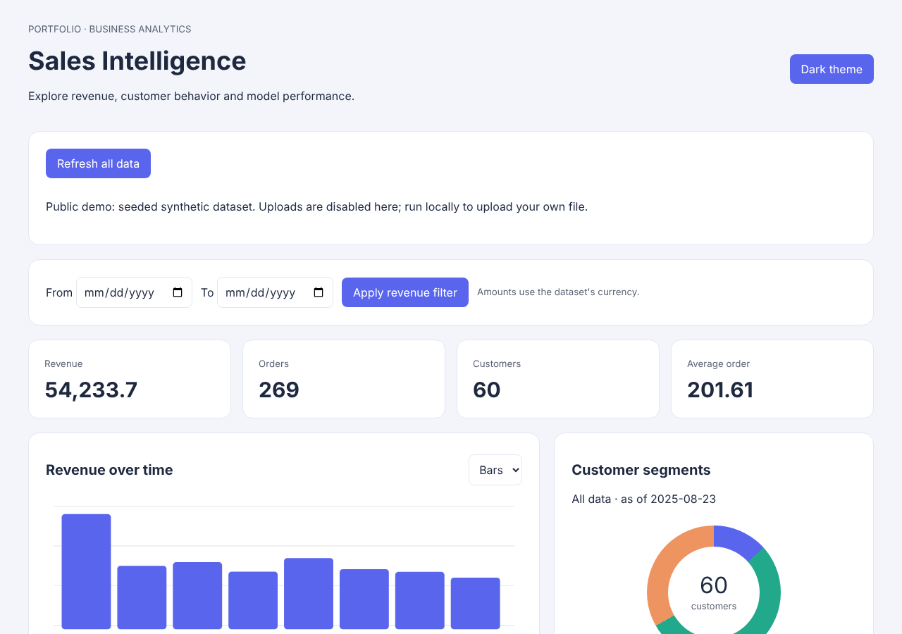

# AI Sales Intelligence

Upload a CSV or Excel file of sales orders and the app shows revenue, orders, customers and average order value. It also charts monthly revenue, groups customers into simple segments, and tests whether a classifier can predict which customers buy again next month. A built-in **Sales Analyst Copilot** answers questions such as "What was revenue last month?" The figures come from the same database queries the dashboard uses, and metric definitions are cited from a checked-in glossary.

This is an independent portfolio project built with React, TypeScript, FastAPI, SQLite, Pandas, scikit-learn and the Anthropic Messages API. All bundled data is synthetic.

## 1. Walkthrough: upload → dashboard → copilot

1. **Upload** `backend/sample_sales.csv` (269 synthetic orders, 60 customers, 1 Jan to 23 Aug 2025). The status line reads `Import complete: 269 added / 0 updated / 0 unchanged`.
2. **Dashboard.** The cards show Revenue **54,233.7**, Orders **269**, Customers **60** and Average order **201.61**. Below them are monthly revenue, segments, a customer explorer, and the model comparison.

   

3. **Copilot.** Click *What was revenue last month?* The answer covers July 2025: revenue 5,722.58 from 29 orders. That matches the July bar on the chart. The *From the database* table is drawn from the tool result, not from the model's text. A definition answer shows its glossary source ID, such as `[repeat-purchase]`.

   

   *These screenshots were captured in **stub mode** (no LLM key), which the orange badge shows. With `ANTHROPIC_API_KEY` set, a model chooses the tools and writes the sentence, and the badge shows the model name.*

**Live demo:** not deployed yet. See [Deploy](#deploy). API docs are served at `/docs` on any running backend.

## 2. Quick start

Requirements: Python 3.12 and Node.js 22. The repository includes a Codespaces dev-container configuration.

**Backend** (terminal 1, from the repository root):

```bash
cd backend
python -m venv .venv
source .venv/bin/activate            # Windows PowerShell: .venv\Scripts\Activate.ps1
python -m pip install --upgrade pip
python -m pip install --only-binary=:all: -r requirements.txt
python -m uvicorn app.main:app --reload --host 0.0.0.0 --port 8000
```

Expected: `Uvicorn running on http://0.0.0.0:8000`. Run `curl http://localhost:8000/api/health` to get `{"status":"ok","orders":0,"demo_mode":false,"copilot_mode":"stub"}`.

**Frontend** (terminal 2, from the repository root):

```bash
cd frontend
npm ci
npm run dev
```

Open http://localhost:5173. Vite proxies `/api` to port 8000. Upload `backend/sample_sales.csv` and check the numbers in the walkthrough above.

**Sample data.** `python generate_sample.py` (run from `backend/`) rebuilds three seeded files deterministically:

| File | Rows | What it tests |
| --- | --- | --- |
| `sample_sales.csv` | 269 | Normal import |
| `sample_updates.csv` | 20 | Re-upload: 10 existing orders with changed amounts, 5 unchanged, 5 new |
| `sample_invalid.csv` | 5 | 4 valid rows, then a negative amount. The whole file is rejected. |

**Environment variables** are all optional and read by the backend only. See [.env.example](.env.example).

| Variable | Default | Purpose |
| --- | --- | --- |
| `ANTHROPIC_API_KEY` | unset | Turns on real LLM tool calling. Without it, the copilot runs in labelled stub mode. |
| `COPILOT_PROVIDER` | auto | `anthropic` or `stub` |
| `COPILOT_MODEL` | `claude-haiku-5-5` | Anthropic model ID |
| `DEMO_MODE` | `0` | `1` seeds the sample into an empty database and disables uploads |
| `SALES_DB` | `backend/sales.db` | SQLite file location |

To turn the copilot on, set the key in the backend terminal before starting uvicorn:

```bash
export ANTHROPIC_API_KEY=sk-ant-...          # PowerShell: $env:ANTHROPIC_API_KEY="sk-ant-..."
# or load a filled-in .env:  set -a; source ../.env; set +a
```

**Single container** (the same image the hosted demo uses):

```bash
docker build -t sales-intel .
docker run --rm -p 8000:8000 -e DEMO_MODE=1 -e ANTHROPIC_API_KEY=$ANTHROPIC_API_KEY sales-intel
python scripts/smoke_test.py http://localhost:8000
```

The dashboard is at http://localhost:8000, served by FastAPI from the built React app.

## 3. How the pieces fit

```
React (Vite) ──/api──► FastAPI ──► app/analytics.py ──► SQLite (orders, uploads)
   │                      │            ▲
   │                      ├─► app/ingest.py (validate + transactional upsert)
   │                      ├─► app/comparison.py (Pandas features → scikit-learn models)
   └─ Copilot panel ──────┴─► app/copilot/service.py ──► Anthropic Messages API (tool calling)
                                   │
                                   ├─ tools.py: get_revenue_summary, compare_periods  → analytics.summary
                                   └─ tools.py: search_metric_glossary → glossary/metrics_glossary.md
```

- **Numbers come from queries.** The model can only call three typed, read-only tools. Their inputs are validated with Pydantic, and unknown tools and extra fields are refused. Both revenue tools call `analytics.summary`, the same function behind the dashboard cards, using parameterized SQL. The model passes period tokens such as `last_month` or `2025-07`, and the backend does the date arithmetic. The UI renders figures from the tool payload. If the model's sentence contains a number that matches no tool value, it is flagged on screen.
- **Definitions come from retrieval.** [backend/glossary/metrics_glossary.md](backend/glossary/metrics_glossary.md) holds each definition with a stable ID and the code location it describes. Simple keyword retrieval returns passages, and the copilot cites their IDs. A term with no entry returns "no glossary entry" rather than a definition from general knowledge.
- **"Last month" is anchored to the data.** Relative periods resolve against the dataset's latest order date (2025-08-23 for the sample), which is the same anchor the segment panel uses. Every answer states the exact date range.
- **Guardrails.** At most 4 tool calls and 4 model turns per question, a 20 s provider timeout, a 30 s overall deadline, and questions capped at 500 characters. In demo mode, each client is limited to 30 questions per 10 minutes. Each request logs its ID, tool names with outcomes, and elapsed time, but not the question text or any order rows.

## 4. Tests, evaluation and limits

```bash
cd backend
python -m pytest -q                 # unit + HTTP tests
python -m eval.run_eval             # 24-question copilot eval, stub provider (no LLM)
python -m eval.run_eval --provider anthropic   # same eval against the real model (needs the key)
python -m eval.classifier_report    # classifier vs majority baseline on the chronological holdout
```

```bash
cd frontend
npx tsc --noEmit
npm run build
```

**Measured on 2026-11-17** (commit `03ece79`, Linux, Python 3.13, pandas 3.0.5, scikit-learn 1.9.1). The pinned requirements specify pandas 2.2.3 and scikit-learn 1.6.1. FastAPI couldn't be installed in that environment. Details are in [docs/EVALUATION.md](docs/EVALUATION.md).

| Check | Result |
| --- | --- |
| pytest | 41 passed. The 3 FastAPI `TestClient` modules were **skipped**, not run. |
| Copilot eval, stub provider | 24/24 cases. Numeric 12/12 against independent SQL and the dashboard function. Citations 6/6. Median latency 2 ms (no network). |
| Copilot eval, real Anthropic model | **Not run yet** (no key in the test environment) |
| Import: sample → updates → invalid | 269 rows in, 269 stored. Re-upload: 20 rows, giving 5 added, 10 updated, 5 unchanged, and 274 stored. Invalid file rejected at line 6, 274 still stored. |
| Failure injected mid-import | Full rollback: no partial rows and no upload record |
| Classifier, test cutoff 2025-06, 60 customers | Validation picked the **majority baseline**. Repeat-buyer F1 is 0.636 for the baseline. As a diagnostic, logistic regression scored 0.629 and random forest 0.483. |

**Known limits**

- On this synthetic data, no learned model beats the "everyone repeats" baseline on F1. The test set is 60 customers with 47% positives, and with that class balance, predicting all-positive already scores F1 0.636. Treat the model panel as an evaluation harness, not a business result.
- The stub-provider eval exercises tools, period resolution, citations, guards and fault handling. It does not measure how well a real LLM chooses tools.
- Analytics read stored orders into memory, and customer pagination happens in the browser. Both suit modest datasets.
- There is no authentication, no per-user data isolation, and no saved model versions.
- **Public demo data mode:** with `DEMO_MODE=1`, the app seeds `sample_sales.csv` into an empty database at start-up and `POST /api/upload` returns 403. Visitors therefore all see the same synthetic data, and nobody's file is stored on a shared server.

## 5. Troubleshooting

- **Upload fails.** The message names the first bad CSV line. Common causes:
  - dates not in `YYYY-MM-DD` (for Excel, use real date cells or ISO text)
  - amounts containing `$` or `1,200`-style separators
  - an empty ID, or the same `order_id` twice in one file
  - a file over 2 MB

  Nothing is stored from a rejected file. In demo mode, uploads are off by design.
- **The dashboard shows "Failed to fetch" or a JSON error.**
  - Check that the backend is running: `curl http://localhost:8000/api/health`.
  - Start the frontend with `npm run dev` from `frontend/` so the `/api` proxy applies.
  - If the API is on another host, add the frontend's origin to `CORS_ORIGINS`.
- **The copilot says "The language model is unavailable…".** Either `ANTHROPIC_API_KEY` is missing, or the provider returned an error or took longer than `COPILOT_TIMEOUT_SECONDS`. Figures already fetched by tools still appear. Check the backend log line `copilot_request` for that request ID. To work without a key, unset `COPILOT_PROVIDER` or set it to `stub`.

## Deploy

[`render.yaml`](render.yaml) defines one Docker web service on Render with `DEMO_MODE=1` and a `/api/health` check:

1. Push this repository to GitHub.
2. In Render, choose **New → Blueprint** and select the repository.
3. Enter `ANTHROPIC_API_KEY` when prompted.
4. Once it's live, run `python scripts/smoke_test.py https://<your-service>.onrender.com`.

Storage choice: demo mode re-seeds read-only synthetic data on every start, so the container's ephemeral disk is enough. To accept uploads on a host, the next step is per-session data isolation plus a persistent disk mounted at `/data` (`SALES_DB=/data/sales.db`). The code is SQLite-specific, so that's a smaller change than moving to PostgreSQL. PostgreSQL becomes worth it once you need more than one instance.

## Reference

**Input data.** The required columns are `order_id,customer_id,order_date,amount`. Extra columns are ignored. Amounts must be greater than 0 and less than 1,000,000,000, and all amounts are assumed to share one unnamed currency. Uploads combine with stored orders, and re-uploading an existing order ID updates that order. One invalid row rejects the whole file. Excel imports read the first worksheet.

**Segments.** Recency is measured to the latest order date. "At risk" means more than 60 days since the last order. "Loyal" means the customer isn't at risk and has 4 or more orders. "Active" covers everyone else. These are rules, not clustering.

**Model comparison.** The target is whether an existing customer orders in the next calendar month. Features use only orders on or before each month-end cutoff, and a test checks this. Candidates train on earlier cutoffs, a later cutoff picks the winner by F1, and the winner is refit and scored on a final test cutoff next to a refit majority baseline. The newest month is excluded because it may be incomplete. No model is saved or deployed.

| Endpoint | Purpose |
| --- | --- |
| `POST /api/upload` | Validate and import CSV or Excel (403 in demo mode) |
| `GET /api/summary` | Revenue metrics, with optional `start` and `end` (inclusive) |
| `GET /api/segments` | RFM customer summaries |
| `GET /api/uploads` | Latest 20 successful imports |
| `POST /api/compare-models` | Temporal model selection and evaluation |
| `GET /api/model-report` | Original logistic-regression experiment |
| `POST /api/copilot` | `{"question": "...", "context": {"start": "...", "end": "..."}}`, returning answer, evidence, citations and request ID |
| `GET /api/health`, `GET /api/config` | Health check, demo mode and copilot mode |

More detail: [evaluation notes](docs/EVALUATION.md) · [engineering story](docs/ENGINEERING_STORY.md)
